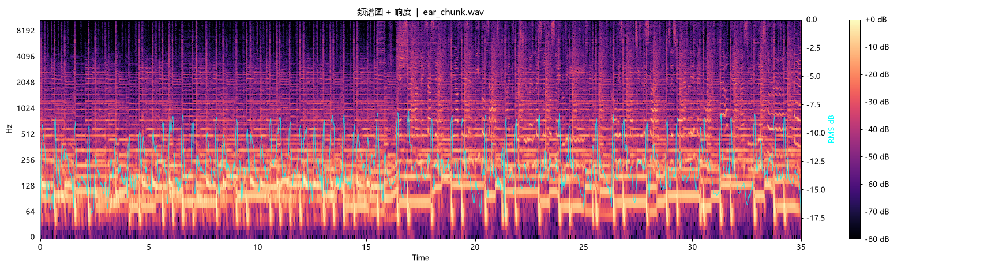

# 🎧 dsh-ears

[](LICENSE)
[](https://www.python.org/)
[](#)

> **给 DSH agent 的一双耳朵：听见电脑上正在放的声音，好不好听由它自己判断。**



> ⚠️ **仅面向 DSH。** 只在这一个框架上测试过，别处未验证。

---

## 它解决什么

只靠**歌名**让模型判断“好不好听”，它会一本正经地胡说（把压抑的曲子说成“宁静”）。
只量 **BPM / 低频占比** 也不靠谱（同一首歌实测量出 99 / 136 / 78，纯噪声）。

dsh-ears 把声音**录下来、画成频谱图**，交给 agent 自己看——它能读出“前面憋着、副歌炸开”，
判断永远由 agent 自己下。**工具只录、只画、只报，不替它判断。**

---

## 快速上手

```bash
pip install -r requirements.txt

python ears_record.py 40 captures/now.wav           # 录 40 秒
python ears_render.py captures/now.wav captures/now.png   # 画频谱图 + shape

python ears_nowplaying.py                            # 可选：当前歌名
python ears_lyrics.py "No differences" "泽野弘之"    # 可选：歌词
```

| 脚本 | 作用 |
|---|---|
| `ears_record.py [秒] [out.wav]` | 录系统回放（默认 40 秒） |
| `ears_render.py <wav> [out.png]` | 画频谱图 + 走向摘要，输出 JSON |
| `ears_nowplaying.py` | 读当前歌名/歌手（Windows，SMTC） |
| `ears_lyrics.py <歌名> [歌手]` | 歌名核对后查歌词 |

## 接到 DSH 上

[`SKILL.md`](SKILL.md) 是给 DSH 的技能说明：提示词模板 + 红线（绝不编歌词、只说你听到的、不用术语）。
可运行示例见 [`examples/demo_agent_flow.py`](examples/demo_agent_flow.py)。

## 局限

- 听得出**声音的样子**，**听不出具体说了什么字**（要字请另配 ASR）。
- 纯音乐没词是常态——讲声音就好，别编词。

## License

MIT。
